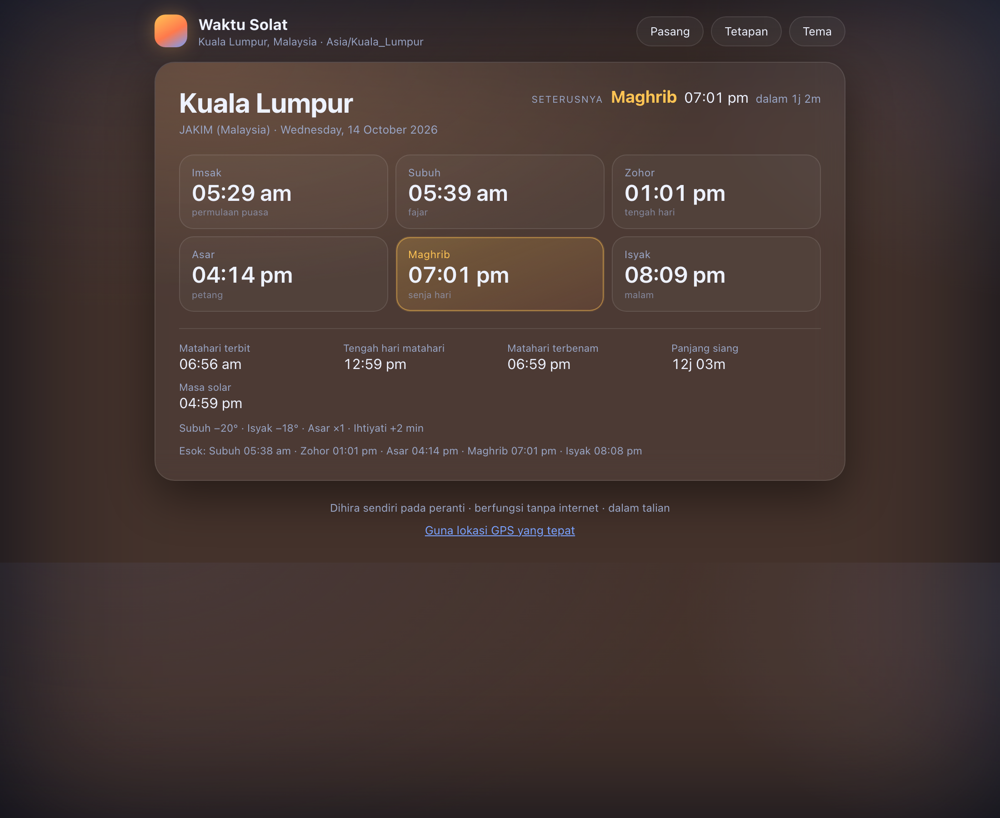

# Waktu Solat

An installable, offline-capable PWA that computes a **jadual waktu solat** from
where you are. Your timezone is detected automatically, so it opens on the right
city with no setup — and everything is calculated on the device: no accounts, no
network, no tracking.



## What you get

- **Imsak, Subuh, Zohor, Asar, Maghrib, Isyak** for today, with the next prayer
  highlighted and a live countdown.
- **Sunrise, solar noon, sunset, day length and apparent solar time** — the solar
  context behind the prayer times.
- **Tomorrow's times** on one line, for planning ahead.
- The background tint follows the sun: warm in daylight, indigo after dark.

## How the times are calculated

| Time | Rule |
|---|---|
| Imsak | 10 minutes before Subuh |
| Subuh | sun 20° below the horizon, rising |
| Zohor | meridian transit + 2 min (ihtiyati) |
| Asar | shadow of an object = its own height + the shadow at noon (Shafi'i factor 1) |
| Maghrib | sunset + 2 min |
| Isyak | sun 18° below the horizon, setting |

Sunrise, sunset and solar noon come from the NOAA solar position algorithm
(mean longitude plus equation of centre, hour angle from Greenwich sidereal time,
−0.833° horizon including refraction and the solar radius). Every other time is a
different altitude threshold on the same solver.

## Location

The app picks a city from your IANA timezone:

1. **Tetapan → Bandar** — override with any of 60 cities. Useful when you are
   travelling but want the times back home.
2. **Guna lokasi GPS yang tepat** — uses your real coordinates, so the times are
   right even somewhere the city list does not cover.
3. If the timezone is unknown, coordinates are approximated from the UTC offset
   and the UI says so.

## Calculation method

Chosen from your timezone by default, overridable in **Tetapan → Kaedah kira**:

| Method | Subuh | Isyak | Notes |
|---|---|---|---|
| JAKIM (Malaysia) | −20° | −18° | +2 min on Zohor and Maghrib |
| Kemenag (Indonesia) | −20° | −18° | +2 min on Zohor and Maghrib |
| Umm al-Qura (Saudi) | −18.5° | — | Isyak = Maghrib + 90 min |
| Egypt / Gulf | −19.5° | −17.5° | |
| Karachi (South Asia) | −18° | −18° | +2 min on Zohor and Maghrib |
| Diyanet (Türkiye) | −18° | −17° | |

Plus an extra **margin keselamatan** of 0–10 minutes, applied to Imsak, Zohor and
Maghrib, so you can match whatever your masjid uses.

Times that never occur at your latitude — Subuh or Isyak inside the polar circles
— show as `—` rather than a wrong guess.

Compare against your mosque's published timetable. If it differs by a minute or
two, moonsighting and rounding conventions vary between authorities; nudge the
margin.

## Live

| | |
|---|---|
| **https://worldclock-two.vercel.app** | Vercel production (`ahb14/worldclock`) |
| **https://796ahb.github.io/waktu-solat/** | GitHub Pages, built from `main` |
| **https://github.com/796AHB/waktu-solat** | source |

Both are installable and work offline. Redeploy with `vercel --prod`; GitHub
Pages rebuilds on every push to `main`.

If the git push fails with `RPC failed; HTTP 400`, your network or proxy is
choking on the pack — bump the buffer:

```bash
git -c http.postBuffer=524288000 push
```

## Run it locally

```bash
./run.sh          # serves on http://127.0.0.1:8899 and opens your browser
./run.sh 3000     # or pick a port
```

A server is required (service workers and the manifest do not work over
`file://`). Any static server works: `python3 -m http.server 8899`, `npx serve .`

## Install it

- **macOS / Android / Windows Chrome or Edge**: click **Pasang**.
- **iPhone / iPad (Safari)**: Share → *Add to Home Screen*.

Once installed it launches standalone with its own icon and works with no
network at all.

## Accuracy

```bash
node verify.js
```

82 checks: published almanac sunrise/sunset times for London, Tokyo, New York,
Sydney, Reykjavík and Cape Town across the solstices and equinoxes; a second,
structurally different implementation of sunrise/sunset (the classic NOAA
spreadsheet formulas) that has to agree within six minutes; invariants (the sun
is at −0.833° at both events, the transit sits at the midpoint of the day, DST
boundaries in five zones, the equation of time at its annual extremes).

The prayer checks verify the rules themselves rather than a table: ordering from
Imsak to Isyak, the sun really is at −20° at Subuh and −18° at Isyak, the Asar
time really does make the shadow one object longer than the noon shadow, Umm
al-Qura Isyak is exactly Maghrib + 90 minutes, the safety margin shifts only the
times it should, impossible times come back null, and the next-prayer search
never returns a moment in the past over a two-day walk.

## Files

```
index.html               markup and the settings sheet
styles.css               theming, light/dark, layout
app.js                   location detection, rendering, settings, install prompt
solar.js                 solar position maths and timezone helpers
prayer.js                solat rules: depression angles and the Asar shadow rule
cities.js                60 cities with coordinates and IANA zones
sw.js                    cache-first service worker (offline)
manifest.webmanifest     PWA metadata
icons/                   generated PNGs + the generator script
run.sh                   local server + browser launcher
vercel.json              static config: clean URLs, no-cache for the worker
verify.js                correctness checks (node verify.js)
shots.mjs                UI smoke test over the Chrome DevTools Protocol
```

## Development notes

- The service worker is **cache-first**, so after editing any file bump
  `VERSION` in `sw.js`, or unregister it from DevTools → Application.
- `node verify.js` runs the maths checks with no dependencies.
- `node shots.mjs` screenshots the app at several sizes. It needs Chrome running
  with `--headless=new --remote-debugging-port=9222`; it clears the service
  worker and HTTP caches first so you always shoot the files on disk.
- `python3 icons/make_icons.py` regenerates the icons (needs numpy; only the
  build step uses it — the app itself has zero dependencies).